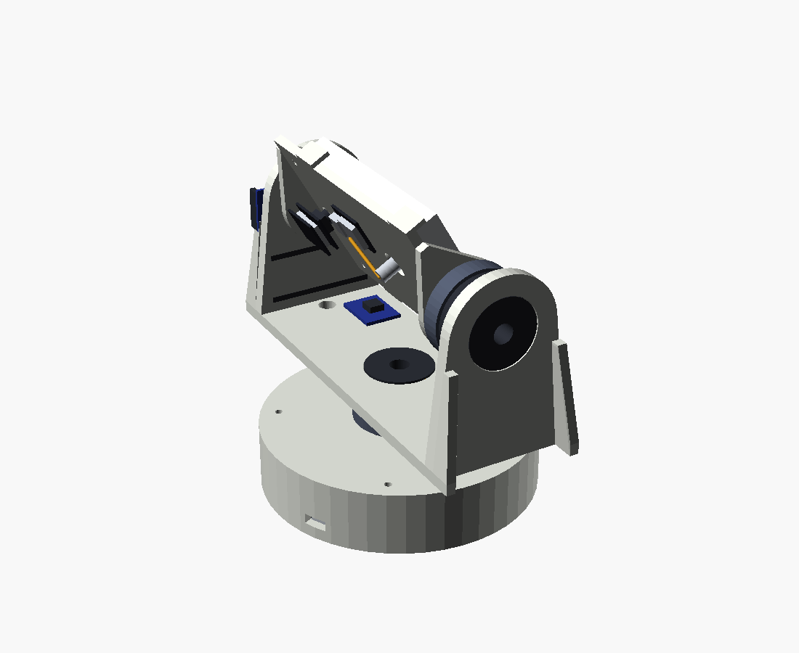
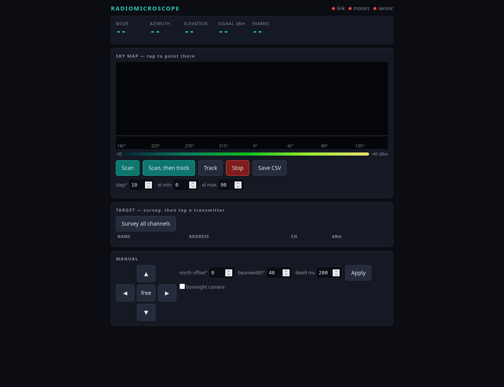
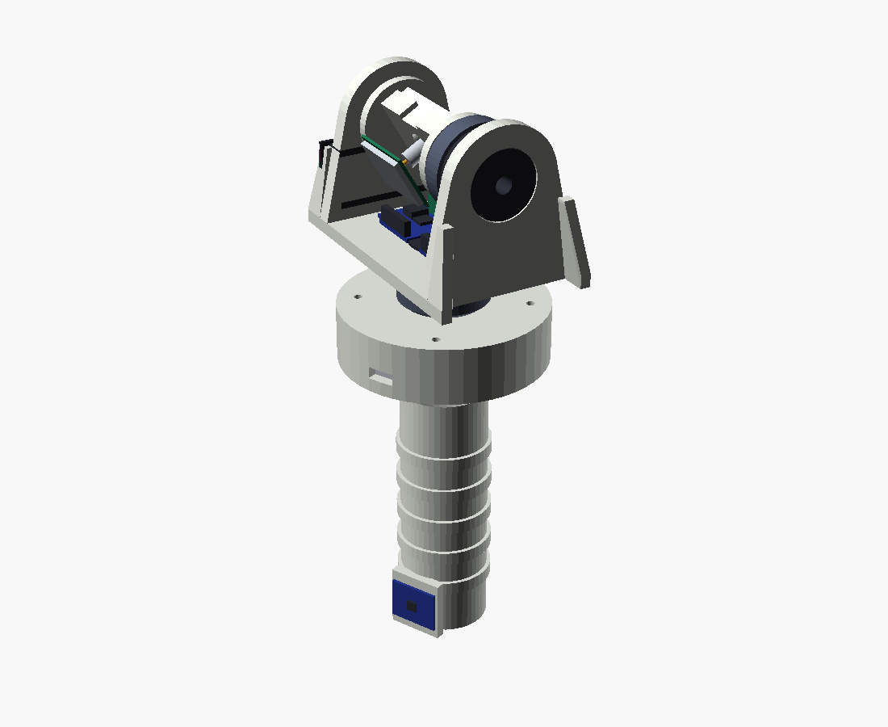
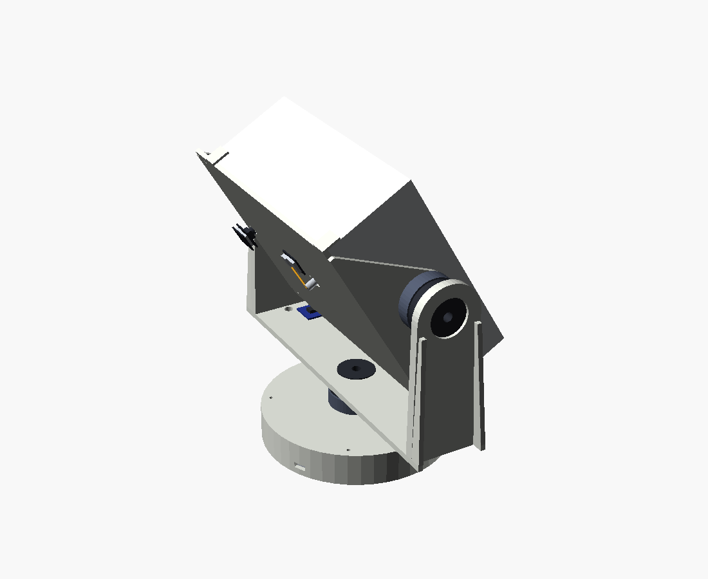

# RadioMicroscope v2

<p align="center"></p>

A desk-sized instrument that points a directional antenna with a two-axis head, records how strong a chosen radio transmitter is in every direction, draws that as a map of the sky around it, and then keeps the antenna locked on the transmitter. A camera looks along the antenna so the radio picture can be compared with what is there.

**Status, 2026-11-11: designed and written, not yet built.** The algorithms pass 133 checks on a PC, and the tool that locates a transmitter from logged bearings passes its own test. The three firmware sketches compile against the ESP32 Arduino core (syntax and types only). Nothing has been linked, flashed or run on hardware, and the printed parts have not been printed. The v1 prototype is in [`archive/v1/`](archive/v1/); the brief for this redesign is [`1.md`](1.md).

## What it does

- **Survey**: lists every Wi-Fi transmitter it can hear on 2.4 GHz and 5 GHz, with channel and strength.
- **Scan**: sweeps the antenna over the hemisphere and maps the strength of one chosen transmitter by direction.
- **Track**: holds the antenna on the transmitter by probing around it; if the signal is lost it scans again and locks on again.
- **Look**: serves a control page over its own Wi-Fi network, with the map, a still camera view along the antenna, manual pointing and CSV export.

### The control page

<p align="center"></p>

Served by the instrument over its own Wi-Fi network. Shown here opened from the file with no instrument connected, so the map and readings are empty.

## How it is built

| Part | What | Why |
|---|---|---|
| Sensor radio | Seeed XIAO ESP32-C5 behind the antenna | The only dual-band (2.4 + 5 GHz) ESP32 board with an antenna socket that could be confirmed on sale in Poland, at 30,90 zł. It only listens. |
| Brain | Seeed XIAO ESP32-S3 Sense (already owned) | Camera, control page, scan and tracking logic. Its own antenna serves the page, so measuring never pauses to talk to the browser. |
| Motor controller | Classic ESP32 board, two SimpleFOC Mini drivers | Runs two brushless gimbal motors in closed-loop angle control. |
| Motors | Two iFlight GM3506 with AS5048A encoders | Direct drive: silent, no backlash, and the encoder reports the true angle. |
| Antenna | Maple Wireless 2.4 GHz 9 dBi patch, 90 × 80 × 10 mm | Light enough for small motors; a 5 GHz panel of the same size swaps onto the same cradle. |
| Power | USB-C Power Delivery | Runs from a PD power bank or charger through one socket. |

The head is about 154 mm wide and 144 mm tall on a 120 mm base. See [`docs/design.md`](docs/design.md) for the full design, [`docs/bom.md`](docs/bom.md) for the parts list with shops and prices, and [`docs/sourcing.md`](docs/sourcing.md) for every shop listing that was checked.

## Targets

| Desktop | Handheld, 5.8 GHz | Long range, 2.4 GHz |
|:---:|:---:|:---:|
|  |  |  |
| 154 × 144 mm, 120 mm base | 81 × 104 mm plus a 115 mm grip | 269 × 262 mm, 160 mm base |

The pictures are renders of the OpenSCAD model in `cad/`, not photographs; nothing has been built yet. Interactive 3D views (drag to turn, sliders to point the antenna) are in `docs/view/`: download one and open it in a browser. They are snapshots from 2026-11-12, built by `tools/build_viewer.py`.

**Current focus: the desktop build.** It is the one to order and assemble first; [`docs/build-desktop.md`](docs/build-desktop.md) is the step-by-step guide.

1. **Desktop**: the build described above, for mapping and tracking Wi-Fi on 2.4 and 5 GHz.
2. **Handheld**: a palm-sized head on a grip (81 × 104 mm plus the grip) that follows a drone's analog video transmitter on 5.8 GHz and keeps facing it while you move. See [`docs/palm-5g8.md`](docs/palm-5g8.md).
3. **Video receiver (VRX)**: the handheld steers by an ESP32-C5 running the ESP-SDR firmware, which measures signal strength but gives no picture; an RX5808 module gives the picture for goggles and can steer the head too. Both are options in the brain firmware; wiring is in the same note.
4. **Long range, 2.4 GHz**: the desk design with a 16 dBi panel antenna and larger motors, for locking onto a distant Wi-Fi network. See [`docs/long-range.md`](docs/long-range.md).

A unit carried on a drone was planned and is parked; the navigation code written for it (compass, IMU, logging, locating) is what lets the handheld hold its direction. See [`docs/navigation.md`](docs/navigation.md).

A bus-servo drivetrain (two Waveshare ST3215 servos, both verified in Polish shops) is kept as a build option: set `DRIVE_BRUSHLESS 0` in `firmware/brain/config.h` and leave out the motor controller.

## Repository

```
1.md                  the brief for this redesign, verbatim
lib/RMCore/           hardware-independent core: sky map, scan pattern, tracker,
                      servo packets, serial links, GPS parser, attitude and
                      bearing-crossing maths (header-only C++)
tests/                PC tests of the core
firmware/sensor/      ESP32-C5: listens and reports signal strength
firmware/brain/       ESP32-S3: modes, control page, camera, drivetrain selection
firmware/motion/      ESP32: brushless motor control
web/index.html        the control page (embedded into the brain firmware)
cad/                  OpenSCAD model, printable STL files, 3D viewer template
tools/                page embedder, compile check, viewer builder, locate.py
docs/                 design, parts list, sourcing record, long-range and handheld variants,
                      navigation
papers/               sources behind the design decisions, with extracts and reports
archive/v1/           the first prototype, unchanged
```

## Working with it

```
make test     # 133 checks of the core plus the locate.py test; needs g++ and python3
make check    # compile-check the three sketches with the installed ESP32 core
make web      # regenerate the embedded control page
make brain    # full build with arduino-cli (likewise: sensor, motion)
python3 tools/build_viewer.py [desk|palm58|longrange24]   # rebuild the 3D view and printable parts
```

`make check` needs the ESP32 Arduino core 3.3.5 or newer in `~/.arduino15`, the ESPAsyncWebServer, AsyncTCP and ArduinoJson libraries, and the Simple FOC library (installed as `~/Arduino/libraries/Simple_FOC`, or pass `SIMPLEFOC=/path/to/Arduino-FOC`). It checks syntax and types only. A real build needs `arduino-cli`.

## What is not done

- No hardware test of any kind. Expect tuning work on the motor control in particular.
- The motor screw pattern and three board outlines in the 3D model are assumed; measure the parts before printing.
- Compass, IMU, turn scan, microSD logging and the bearing-crossing tool are written but untried on hardware: see [`docs/navigation.md`](docs/navigation.md). Without them the north offset is typed in by hand.
- Researched but not implemented: a spectrum mode using the ESP-SDR firmware on the same sensor board, steering by existing satellite-tracking software, and sharpening maps by removing the antenna's beam shape. See the roadmap in the design document.
