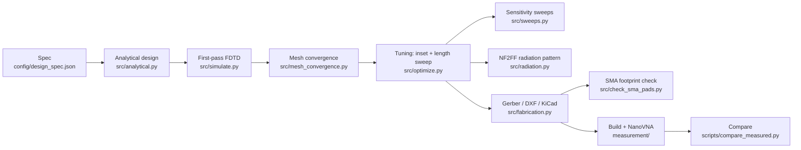

# 2.45 GHz inset-fed microstrip patch antenna on FR4 (openEMS)

This project designs, simulates, tunes and prepares for fabrication a rectangular
microstrip patch antenna for the 2.4 GHz ISM band, on ordinary 1.6 mm FR4. It runs
from textbook formulas, through full-wave FDTD simulation with
[openEMS](https://openems.de), to Gerber files you can send to a PCB fab.

Everything is scripted and reproducible, and every number in this README comes from
a script in this repository.

> **Status: simulation only.** No board has been built or measured yet. The
> `measurement/` folder and `scripts/compare_measured.py` are ready for the first
> NanoVNA measurement.

## Results

| Quantity | Simulated (openEMS, fine mesh) | Target |
|---|---|---|
| Resonant frequency (S11 minimum) | **2.4507 GHz** | 2.45 GHz |
| S11 at resonance / at 2.45 GHz | **−46.8 dB** / −43.7 dB | better than −15 dB |
| −10 dB bandwidth | **67.4 MHz** (2.4167–2.4841 GHz, 2.75 %) | — |
| VSWR at resonance | 1.01 | — |
| Peak directivity | 6.57 dBi | — |
| Peak gain (IEEE) | **3.26 dBi** | — |
| Radiation efficiency | **46.7 %** | — |
| Half-power beamwidth, E / H plane | 93.0° / 89.1° | — |
| Front-to-back ratio | 14.0 dB | — |

**Final design:**

| Parameter | Value |
|---|---|
| Patch | W = 37.23 mm, L = 28.69 mm |
| Inset depth | y0 = 7.99 mm |
| Inset gap | g = 1.00 mm |
| 50 Ω feed width | Wf = 3.00 mm |
| Board | 60 × 60 mm, FR4 (εr 4.4, tan δ 0.02), 1.6 mm, 35 µm copper |

All values are in [config/final_design.json](config/final_design.json).

**How solid these numbers are:**
- **Mesh.** On a 1.5 M-cell extra-fine mesh the resonance is 2.4517 GHz (+0.04 %).
- **Mesh for the pattern.** The medium mesh gives the gain and efficiency within 0.02 dB and 0.3 points.
- **SMA pads.** Adding the SMA ground pads and vias moves the resonance by −0.4 MHz.

**Shortfall.** The −10 dB band does not cover the bottom of the ISM band: S11 is −7.05 dB at
2.400 GHz. The patch's bandwidth (67 MHz) is narrower than the band (83.5 MHz), which is
typical for a patch on 1.6 mm FR4. See [Limitations](#limitations).

## Design flow



| Step | Result |
|---|---|
| Analytical design (transmission-line model) | W 37.23, L 28.81, y0 10.69 mm ([table](results/analytical_design.md)) |
| First-pass FDTD | 2.431 GHz, S11 −9.7 dB: the inset is too deep, because the formula ignores FR4 loss |
| Mesh convergence, 4 levels | Fine → extra-fine moves f_res by 0.04 % ([report](results/mesh_convergence.md)) |
| Tuning, 13 logged runs | L 28.69, y0 7.99 mm → 2.4507 GHz, −46.8 dB ([iteration log](docs/iteration_log.md)) |
| Radiation (NF2FF) | 3.26 dBi, 46.7 % efficiency ([summary](results/radiation_summary.md)) |
| Fabrication | Gerbers, drill, DXF/SVG, KiCad footprint ([fabrication/](fabrication/README.md)) |

## Geometry


The feed line enters from the bottom board edge, where an edge-launch SMA connector is
soldered. The notch on each side of the feed line is the inset that matches the patch
to 50 Ω.

## Plots

**S11 and input impedance.**

| S11 | Smith chart |
|---|---|
|  |  |

**Radiation pattern at 2.4507 GHz.**


| 3D gain pattern | Fields on the patch |
|---|---|
|  |  |

**Mesh convergence and the biggest manufacturing sensitivity (FR4 permittivity).**

| Mesh convergence | εr sweep (−26 MHz per +0.1) |
|---|---|
|  |  |

More sweeps (patch length, inset depth, loss tangent) are in [results/sweeps.md](results/sweeps.md).

**Fabrication layout.**


## Project structure

```
openems-patch-antenna/
├── config/
│   ├── design_spec.json        target, substrate, board (inputs)
│   ├── first_pass_design.json  analytical geometry (generated)
│   ├── final_design.json       tuned geometry + verification (generated)
│   └── fabrication.json        SMA pads, fab options
├── src/
│   ├── analytical.py           TL-model design equations -> results/analytical_design.md
│   ├── geometry.py             Geometry dataclass, copper outline (shared by sim and fab)
│   ├── simulate.py             openEMS model, mesh rule, port, S11/Smith/VSWR outputs
│   ├── mesh_convergence.py     4-level mesh study
│   ├── runner.py               cached, parallel simulation runner
│   ├── optimize.py             inset/length tuning, writes docs/iteration_log.md
│   ├── sweeps.py               L, y0, tan δ, εr sensitivity sweeps
│   ├── radiation.py            NF2FF: patterns, gain, efficiency, HPBW, field plots
│   ├── fabrication.py          Gerber, Excellon, DXF, SVG, KiCad footprint
│   ├── check_sma_pads.py       re-simulation with the SMA footprint
│   └── plotstyle.py            shared plot style
├── scripts/
│   ├── validate_toolchain.py   runs the official openEMS patch tutorial (Phase 1 check)
│   └── compare_measured.py     measured vs simulated S11 (skips if no data)
├── tests/                      58 pytest tests (no openEMS run needed)
├── results/                    all plots, CSV, Touchstone, markdown reports
├── docs/iteration_log.md       every tuning iteration with parameters and results
├── fabrication/                Gerbers + zip, drill, DXF, SVG, KiCad, ordering notes
├── measurement/                NanoVNA how-to, CSV template, data/ (empty until measured)
├── NOTES.md                    plain-language background with worked numbers
├── Makefile  requirements.txt  LICENSE
```

## Prerequisites

- **Linux, or Windows with WSL2.** This project was run on Ubuntu 24.04 under WSL2.
- **openEMS and CSXCAD built from source with Python bindings**, following the official
  instructions at <https://docs.openems.de>:

  ```bash
  sudo apt-get install build-essential cmake git libhdf5-dev libboost-all-dev libtinyxml-dev \
      zlib1g-dev qtbase5-dev libvtk9-dev libvtk9-qt-dev python3-pip python3-venv
  git clone --recursive https://github.com/thliebig/openEMS-Project.git ~/src/openEMS-Project
  cd ~/src/openEMS-Project
  ./update_openEMS.sh ~/opt/openEMS --python
  ```

  The build script creates a venv at `~/opt/openEMS/venv` with the `openEMS` and `CSXCAD`
  Python packages. Versions used here: openEMS 0.37.0 and CSXCAD 0.7.0.
- **Python packages** (pinned) in that venv:

  ```bash
  source ~/opt/openEMS/venv/bin/activate
  pip install -r requirements.txt
  ```

- **Optional:** `gerbv` or KiCad, to inspect the Gerbers. Neither is needed to generate them.

**Under WSL2, cap openEMS threads.** Letting openEMS use all 16 threads crashed the WSL VM
twice on the development laptop. The scripts default to 4 threads per run and at most
3 runs in parallel (`OPENEMS_THREADS`, `OPENEMS_JOBS`).

## How to reproduce

Run from the project folder, inside the openEMS venv. Raw openEMS data (large) goes to
`$OPENEMS_SIM_DIR` (default `./sim_output`, which is git-ignored). Runs are cached
there, so repeating a step only redoes the post-processing.

```bash
source ~/opt/openEMS/venv/bin/activate
export OPENEMS_SIM_DIR=~/openems-sims     # optional; keep it on the Linux file system under WSL
make test                                 # 58 unit tests, seconds, no openEMS run
make design                               # analytical table           (seconds)
make sim                                  # first pass + mesh study    (~30 min)
make optimize                             # tuning, iteration log      (~40 min)
make sweep                                # sensitivity sweeps         (~15 min)
make pattern                              # NF2FF patterns             (~10 min)
make fab                                  # Gerber/DXF/SVG/KiCad       (seconds)
make sma-check                            # SMA footprint re-simulation (~32 min)
make measure                              # overlay measured S11 (needs measurement/data/)
```

The times are for 4 threads per run on a 16-thread laptop. `make all` runs design → fab
and then the tests. To check the toolchain itself against the official openEMS tutorial,
run `make toolchain`.

## Limitations

- **Simulation only.** Nothing has been measured. Treat every number above as a prediction
  until `scripts/compare_measured.py` has a real NanoVNA file to compare against.
- **FR4 tolerance.** The resonance moves about −26 MHz per +0.1 in εr. Generic FR4 ranges
  from about 4.2 to 4.6 at 2.4 GHz, so a ±0.2 spread shifts the band by about ±52 MHz, and
  S11 at 2.45 GHz would then be only about −7 dB. Loss tangent also varies. The
  tuned inset relies on tan δ ≈ 0.02: with a lossless substrate the match only reaches
  −9.75 dB. Expect to trim L on a first prototype (1 mm ≈ 79 MHz).
- **Bandwidth.** 67 MHz at −10 dB does not cover the full 83.5 MHz ISM band. 2.400 GHz is
  at −7 dB. Covering the band needs a thicker or lower-εr substrate, not re-tuning.
- **Finite ground plane.** The 60 × 60 mm ground is included in every simulation, so its
  effect on resonance and pattern is in the results: the back lobe gives 14 dB front-to-back,
  and the E-plane is asymmetric because of the feed side. A different board size will change
  the pattern and shift the resonance slightly.
- **No enclosure or connector model.** The SMA connector body, solder and any housing or
  mounting are not simulated. The SMA *footprint* (pads and vias) was checked
  (−0.4 MHz), but the pad-to-pin transition lies on the source side of the port's probes, so
  its reflection is not captured.
- **Model simplifications.**
  - Copper is a 35 µm conducting sheet with bulk conductivity: no surface roughness, no plating
    or finish.
  - FR4 is a single εr with tan δ exact at 2.45 GHz (no frequency dispersion).
  - No solder mask on the antenna side; the fab files remove it there on purpose.
- **Fab files not checked in a viewer.** The Gerbers and the KiCad footprint have not been
  opened in KiCad or gerbv. The automated tests read them back and check the geometry. Look
  at the fab's online Gerber viewer before ordering.

## Background

[NOTES.md](NOTES.md) explains the ideas in plain language with worked numbers: why a patch
radiates, the design equations by hand, S11/VSWR/bandwidth, FDTD/mesh/PML, gain versus
directivity versus efficiency, why FR4 is lossy, and what the results mean in practice.

## License

MIT, see [LICENSE](LICENSE). openEMS and CSXCAD are separate projects under their own
(GPL) licenses. They are not included here. `scripts/validate_toolchain.py` runs the
official tutorial from your openEMS checkout without copying it.
